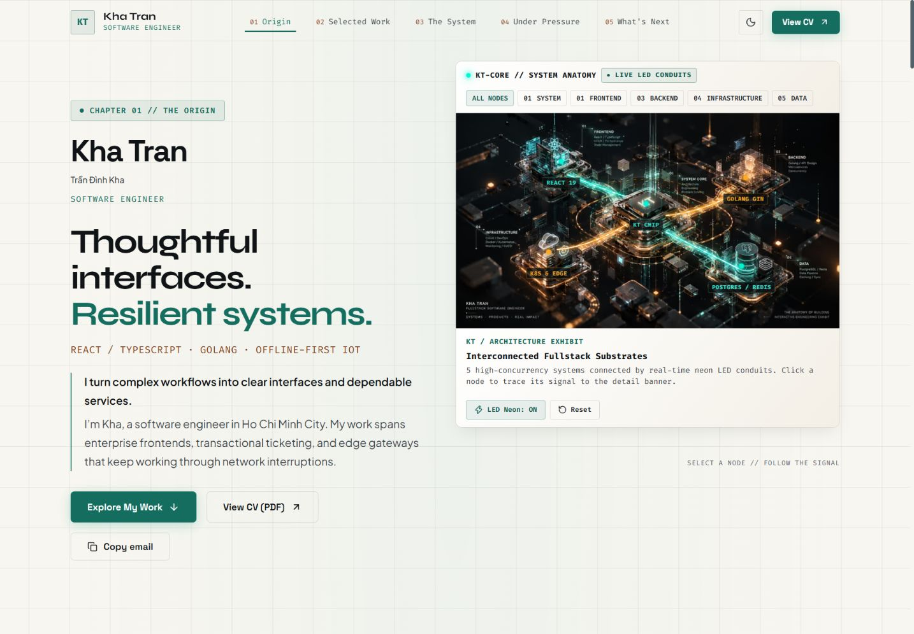
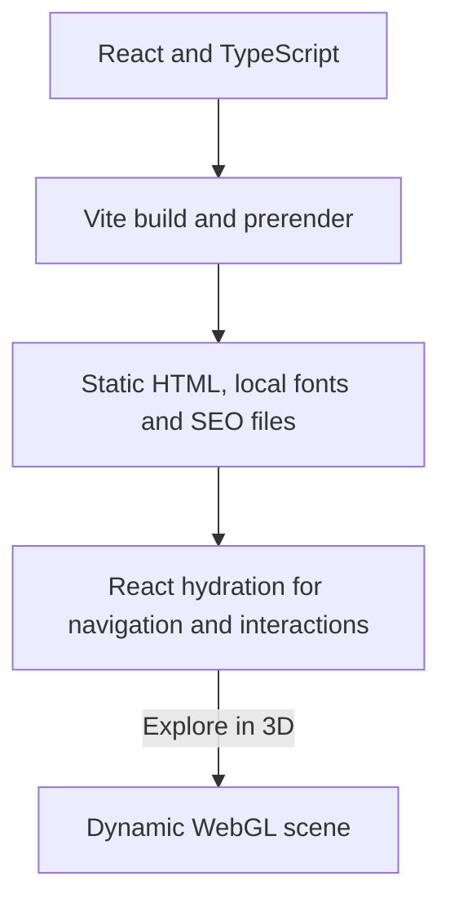

# Kha Tran — Software Engineer

React + TypeScript portfolio, built with Vite and prerendered to static HTML for GitHub Pages. The generated page includes the hero, experience, architecture overview, project summaries, and contact details before JavaScript runs. React hydrates that HTML to enable the existing gallery, simulations, dialogs, and theme switcher.



## Architecture and interaction



Selected Work appears before the optional architecture experience. The architecture tabs, node descriptions, and layer summaries work without starting WebGL. **Explore in 3D** loads the existing galaxy scene; **Exit 3D** or **Escape** releases it. Wheel zoom is off until explicitly enabled, and a selected node stays focused while the page scrolls. The existing demand-rendering, viewport pause, adaptive DPR, reduced-motion support, and fallback are retained.

See [the optimization review](OPTIMIZATION-REVIEW.md) for the accepted, already resolved, and deferred suggestions.

In 3D mode, drag to rotate at every layer and while inspecting a node. Focus the scene and use arrow keys for keyboard rotation; **Home** or **Reset rotation** restores the angle. On touchscreens, horizontal dragging rotates while vertical gestures retain page scrolling.

## Local development

```sh
npm ci
npm run dev
```

To inspect the actual static deployment, run:

```sh
npm run build
npm run preview
```

Use the Local URL printed by Vite. `npm run build` runs TypeScript, builds assets, prerenders the same React application, generates SEO files, and verifies the output. `npm run check:build` reruns the artifact checks. `dist/` is the deployment output; the historical `docs/` snapshot is not rebuilt by this workflow.

Artifact checks also walk Vite's import manifest to keep optional graphics out of initial JavaScript and enforce a **160 KiB gzip** initial-JS budget. Vite warns at **500 kB** per chunk; a large optional WebGL chunk remains visible as a warning. This is a bundle check, not a Lighthouse or Core Web Vitals measurement.

## GitHub Pages and the shorter URL

The build now targets **`https://khatran1012.github.io/`** with Vite **`base: '/'`**. Canonical, Open Graph, JSON-LD, sitemap, robots and asset paths use the same account-root configuration. `GITHUB_REPOSITORY` does not switch the build back to the old project prefix.

To use `https://khatran1012.github.io/`:

1. Rename the GitHub repository to **`khatran1012.github.io`** in repository Settings.
2. Set **Settings → Pages → Build and deployment → Source** to **GitHub Actions**.
3. Update the local remote: `git remote set-url origin https://github.com/khatran1012/khatran1012.github.io.git`.
4. Run the existing Deploy to GitHub Pages workflow, or push the reviewed changes to `master`.

Rename the repository before deploying this root build. The existing `/khatran.github.io/` redirect file preserves old links after the user site is deployed, including their query and fragment when JavaScript is available. It redirects to the root of the current host, so old localhost links also remain usable. GitHub Pages does not provide configurable server-side 301 redirects.

The default local build already uses the root path:

```sh
npm run build
npm run preview
```

For a custom domain, set `VITE_SITE_URL` to its root URL before building. Subpath values are rejected to keep metadata consistent with `base: '/'`.

## Project media and claims

Featured projects use concise Problem → Solution → Outcome summaries from the existing CV content. The supplied diagrams are explicitly labeled engineering illustrations. Public website links are shown only where an address exists; no private repository or unavailable demo is invented.

To add a real recording, place a small `.webm` in `public/` and set the project's `previewVideo` path in `src/data/cvData.ts` (relative to `public/`, without a leading slash). A preview loads on hover or explicit play, stays muted and looping, and pauses on pointer leave or when the tab is hidden. Reduced-motion preferences disable hover playback. Add `sourceUrl` only when a public source repository is available.

Fonts are served locally. Plus Jakarta Sans includes matching Latin and Vietnamese subsets with Unicode ranges and `font-display: swap`; Vietnamese text uses the body font rather than Syne. Font license files live in `public/fonts/`.

Performance scores, production Core Web Vitals, conversion changes, and formal accessibility conformance require separate measurement. The build does not claim a Lighthouse score.

References: [React hydration](https://react.dev/reference/react-dom/client/hydrateRoot), [GitHub Pages user sites](https://docs.github.com/en/pages/quickstart).
